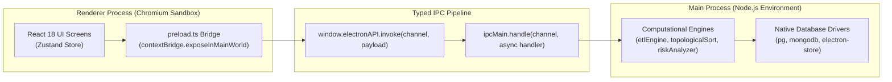
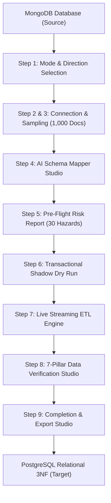
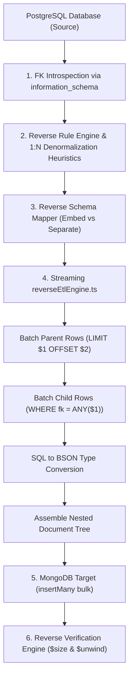
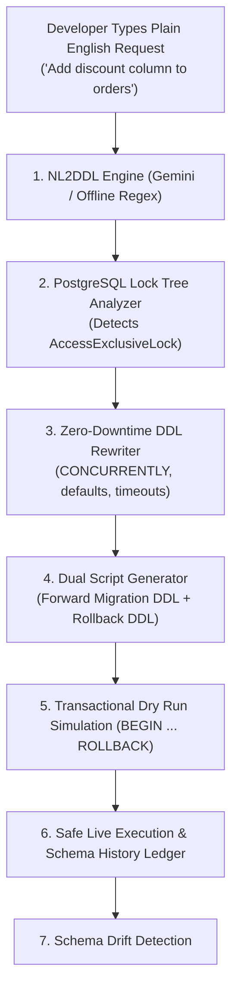

# 🚀 MigrateIQ — The Complete Master Encyclopedia & Viva Defense Bible
## An Exhaustive, End-to-End Guide to Every Screen, Engine, Algorithm, and Line of Architecture in MigrateIQ

---

## 📌 How to Use This Guide

1. **How to set up and run the project** on your laptop in 5 minutes.
2. **What the project actually does** in simple everyday language.
3. **The 3 main parts of the project** (MongoDB → PostgreSQL, PostgreSQL → MongoDB, and the Application/Schema Assistant).
4. **All technical terms and algorithms explained simply** so you sound like a database expert.
5. **A step-by-step Live Demo Guide** for what to click during your viva.
6. **The Top 35 Viva Questions & Answers** that the examiner is guaranteed to ask.

Read this guide once or twice, and you will understand the entire project better than 99% of students.

---

# TABLE OF CONTENTS
1. [Project Overview: What is MigrateIQ & What Problem Does It Solve?](#1-project-overview-what-is-migrateiq--what-problem-does-it-solve)
2. [Quickstart: How to Clone, Install, Seed, and Run](#2-quickstart-how-to-clone-install-seed-and-run)
3. [Monorepo & System Architecture (Electron + React + Node.js)](#3-monorepo--system-architecture-electron--react--nodejs)
4. [Tour of Every Screen in the Application (Screens 1 to 14)](#4-tour-of-every-screen-in-the-application-screens-1-to-14)
5. [Deep Dive: Part 1 — MongoDB → PostgreSQL Migration (Workflow A)](#5-deep-dive-part-1--mongodb--postgresql-migration-workflow-a)
6. [Deep Dive: Part 2 — PostgreSQL → MongoDB Reverse Migration (Workflow B)](#6-deep-dive-part-2--postgresql--mongodb-reverse-migration-workflow-b)
7. [Deep Dive: Part 3 — Schema Update Assistant & DDL Evolution (Workflow C)](#7-deep-dive-part-3--schema-update-assistant--ddl-evolution-workflow-c)
8. [The 12 Backend Engines: How the Computational Brain Works](#8-the-12-backend-engines-how-the-computational-brain-works)
9. [Technical Glossary: Complicated Concepts in Plain English](#9-technical-glossary-complicated-concepts-in-plain-english)
10. [Step-by-Step Live Viva Demonstration Script](#10-step-by-step-live-viva-demonstration-script)
11. [Master Viva Q&A: Top 35 Tough Examiner Questions & Answers](#11-master-viva-qa-top-35-tough-examiner-questions--answers)

---

# 1. Project Overview: What is MigrateIQ & What Problem Does It Solve?

### 1.1 The Fundamental Database Divide
In modern software engineering, data is stored in two fundamentally different database paradigms:
1. **NoSQL / Document-Oriented (MongoDB):**
   - Stores data in hierarchical, flexible JSON-like documents called **BSON** (Binary JSON).
   - Objects can be deeply nested: an `order` document contains an embedded array of `items`, each with its own `product_id`, `quantity`, and `price`.
   - Great for fast prototyping because there is no rigid schema.
   - **The Problem:** As companies grow to millions of dollars in revenue, flexible schemas become dangerous. You have no foreign key constraints, no referential integrity, and one buggy API endpoint can write `price: "free"` as a string instead of a float.
2. **Relational / SQL (PostgreSQL):**
   - Stores data in strict tables with strict column types, primary keys, foreign keys, and indexes.
   - Enforces **ACID transactions** (Atomicity, Consistency, Isolation, Durability) and **Third Normal Form (3NF)**.
   - Prevents data duplication and guarantees relational integrity.
   - Essential for financial transactions, e-commerce, banking, and ERP systems.

### 1.2 Why Database Migration is a Nightmare (The Problem We Solve)
When a company outgrows MongoDB and needs to move to PostgreSQL, they face catastrophic technical roadblocks:
- **Nested Array Flattener:** PostgreSQL tables cannot store arrays of objects in a single column without violating 1NF (First Normal Form). You must separate them into child tables linked by foreign keys, while preserving the original array order.
- **Type Incompatibilities:** MongoDB has types like `ObjectId` (24-hex char), `Decimal128` (128-bit float), and `ISODate`. If converted naively, money values suffer rounding errors.
- **Memory Crashes:** Standard Node.js scripts crash with `JavaScript heap out of memory` when loading collections with 100,000+ documents.
- **Existing Tools Fail:**
  - *AWS Database Migration Service (DMS):* Requires expensive cloud infrastructure, treats MongoDB like flat text tables, and doesn't rebuild relational child tables.
  - *pgloader:* Command-line only, crashes on complex nested BSON structures, and offers zero pre-flight risk analysis.

### 1.3 What MigrateIQ Does
**MigrateIQ is an intelligent, visual, bi-directional database migration and schema management desktop suite.**
It provides:
- **Automated Normalization:** Introspects MongoDB, suggests relational 3NF tables, and converts nested arrays into child tables with foreign keys and `sort_order` columns.
- **Bi-Directional Support:** Migrates **MongoDB $\to$ PostgreSQL** (Workflow A) AND **PostgreSQL $\to$ MongoDB** (Workflow B - Denormalization).
- **Dual AI & Rule Engine:** Uses Google Gemini (or Groq Llama 3) for semantic column renaming, backed by a **100% offline deterministic rule engine**.
- **Zero Data Loss Guarantee:** Runs pre-flight risk checks across 30 hazards, performs transactional dry runs (`BEGIN ... ROLLBACK`), streams data in cursor batches, and executes a 7-pillar Data Verification Studio proving $0.00\%$ financial drift.
- **Schema Copilot (Workflow C):** Allows engineers to evolve schemas using plain English (Natural Language to DDL) with automatic PostgreSQL lock analysis.

---

# 2. Quickstart: How to Clone, Install, Seed, and Run

### 2.1 Prerequisites on Your Computer
- **Node.js:** Version 20 LTS or higher (`node -v`).
- **Git:** Installed and in PATH (`git --version`).
- **VS Code:** Recommended editor.

### 2.2 Step-by-Step Terminal Commands
Open your terminal (PowerShell or Git Bash) and execute:

```bash
# 1. Clone the project repository
git clone https://github.com/Siddhesh1401/MigrateIQ.git

# 2. Move into the project directory
cd MigrateIQ

# 3. Install all dependencies across all workspaces
npm install

# 4. Compile the shared TypeScript models (MANDATORY STEP)
npm run shared:build
```

> ⚠️ **CRITICAL TROUBLESHOOTING TIP:**
> If you ever see an error saying `Cannot find module '@migrateiq/shared'` or type errors during build, simply run:
> ```bash
> npm run shared:build
> ```
> This compiles `packages/shared/src/` into JavaScript and declaration files in `packages/shared/dist/`.

### 2.3 Setting Up Environment Variables (`.env`)
In the root folder, create or check `.env`:
```env
GEMINI_API_KEY=your_gemini_api_key_here
GROQ_API_KEY=your_groq_api_key_here
```
*(Note: If you do not have an API key, the app still runs 100% perfectly using its built-in **Offline Rule Engine**!)*

### 2.4 Seeding the Industrial Test Databases (The Final Exam Testbeds)
We have created 3 dedicated, industrial-grade testbed scripts with thousands of records, nested arrays, and foreign keys:

```bash
# Option 1: Seed ALL 3 workflows in one single command:
npm run seed:final-all

# Or seed individually:
# 1. Workflow A (MongoDB → PostgreSQL):
#    Source: "final_mongo_workflow_a" (~2,985 docs, nested items & tracking events)
#    Target: "final_postgres_workflow_a" (Pristine 0 tables ready for live migration)
npm run seed:final-a

# 2. Workflow B (PostgreSQL → MongoDB Reverse Denormalization):
#    Source: "final_postgres_workflow_b" (5,265 rows across 10 normalized 3NF tables)
#    Target: "final_mongo_workflow_b" (Pristine clean database ready for reverse ETL)
npm run seed:final-b

# 3. Workflow C (Schema Update Assistant / Copilot):
#    Target: "final_postgres_workflow_c" (9,025 active records in Fintech ledger)
#    Target: "final_mongo_workflow_c" (500 documents with active $jsonSchema validation)
npm run seed:final-c
```

### 2.5 Launching the Apps

#### 🖥️ Run the Desktop Application (The Main Exam App):
```bash
npm run desktop:dev
```
- Electron launches automatically with Vite hot-reloading!

#### 🌐 Run the SaaS Marketing Landing Website:
```bash
npm run web:dev
```
- Opens the Next.js 14 marketing portal at `http://localhost:3000`.

---

# 3. Monorepo & System Architecture (Electron + React + Node.js)

When the examiner asks: *"Explain the architecture of your system,"* this is the section to explain.

### 3.1 Monorepo Structure (`npm workspaces`)
MigrateIQ uses an **npm workspaces monorepo** configured in the root `package.json`:
- `apps/desktop`: The native desktop software built with **Electron 28**, **React 18**, **TypeScript**, and **Vite**.
- `apps/web`: The public SaaS landing portal built with **Next.js 14 (App Router)** and CSS Modules.
- `packages/shared`: A standalone TypeScript package containing all shared data interfaces, DTOs, and type definitions used across both frontend and backend.

```
MigrateIQ/
├── apps/
│   ├── desktop/
│   │   ├── main/          ← Electron Main Process (Node.js engine & drivers)
│   │   │   ├── engine/    ← 12 specialized migration & analysis engines
│   │   │   ├── handlers/  ← IPC channel listeners (db, ai, migration, store)
│   │   │   └── main.ts    ← Application lifecycle, window creation & security
│   │   └── renderer/      ← Electron Renderer Process (React 18 frontend)
│   │       ├── src/
│   │       │   ├── screens/    ← 14 feature screens
│   │       │   ├── components/ ← Reusable UI widgets, modals, verification tabs
│   │       │   ├── store/      ← Zustand state stores (wizardStore.ts)
│   │       │   └── styles/     ← Clean light-theme CSS styles
│   └── web/               ← Next.js 14 web marketing app
├── packages/
│   └── shared/            ← Shared TypeScript types (@migrateiq/shared)
├── scripts/               ← 60+ diagnostic, verification, and seeding scripts
└── documentation/         ← Phase-by-phase technical documentation
```

### 3.2 The Electron Process Model & IPC Bridge
Electron divides execution into two isolated processes for security:



1. **The Renderer Process (React 18):**
   - Runs inside a secure Chromium browser sandbox.
   - It **cannot** directly import `fs`, execute shell commands, or open raw database TCP sockets.
   - It only renders the UI and manages local user state.
2. **The Main Process (Node.js):**
   - Runs in full Node.js.
   - It has direct access to the operating system, file system, and native database drivers (`pg` for PostgreSQL and `mongodb` native driver).
   - This is where our ETL streaming engines and graph algorithms run.
3. **The IPC (Inter-Process Communication) Bridge:**
   - Communication between UI and backend happens through `preload.ts` using `contextBridge.exposeInMainWorld('electronAPI', ...)`.
   - Every IPC handler uses `ipcMain.handle` and strictly returns a typed object:
     ```typescript
     { success: boolean, data?: T, error?: string }
     ```
   - This ensures the UI never crashes on an unhandled promise rejection.

### 3.3 State Management & Persistence
- **Runtime State:** Managed using **Zustand** in `apps/desktop/renderer/src/store/wizardStore.ts`. Stores current wizard steps, selected connections, active schema mappings, and live verification data.
- **Persistent Storage:** Managed using **`electron-store`** on disk (`migrateiq-data.json`). Safely stores saved database profiles, migration history records, schema update history, and user settings.

### 3.4 Strict Light-Theme UI/UX
The UI follows an enterprise light theme:
- **Background Canvas:** `#F8FAFC` (Slate-50)
- **Cards & Surfaces:** `#FFFFFF` (Pure White)
- **Borders:** `#E2E8F0` (Slate-200 crisp 1px borders)
- **Primary Action Blue:** `#2563EB` (Royal Blue)
- **Text:** `#0F172A` (Deep Slate Navy)
- **Typography:** Inter font family.

### 3.5 Master Electron IPC Channel Directory (56 Typed Handlers)
Every interaction between the React UI and the Node.js backend passes through explicit typed IPC channels (`ipcMain.handle`). Here is the complete verified registry across all 13 backend handler modules:

| Handler File | IPC Channels Registered | Purpose |
| :--- | :--- | :--- |
| `db.ts` | `db:connect-mongodb`<br>`db:connect-postgresql`<br>`db:clear-target`<br>`db:test-connection` | Native database connection testing, statistical sampling (1,000 docs), permission verification, and real-time latency ping (`ms`). |
| `ai.ts` & `aiUsageStore.ts` | `ai:generate-mapping`<br>`ai:health-score`<br>`ai:refine-mapping`<br>`ai:suggest-anomaly-fixes`<br>`ai:test-key`<br>`ai:get-usage-stats`<br>`ai:get-usage-logs`<br>`ai:clear-usage-logs`<br>`ai:reset-usage-all` | Google Gemini & Groq prompt synthesis, anomaly resolution, live API key validation, and token quota tracking (1,500/day limit). |
| `risk.ts` | `risk:analyze` | Pre-flight static analysis checking 30 hazard rules and generating in-memory auto-fix actions. |
| `dryRun.ts` | `migration:dry-run`<br>`dossier:export-pdf` | Transactional shadow simulation wrapped in `BEGIN ... ROLLBACK`, and pre-flight PDF risk dossier generation. |
| `migration.ts` | `migration:start`<br>`migration:cancel`<br>`migration:get-rollback`<br>`migration:execute-rollback` | Core ETL streaming execution, cancellation handler, rollback script loader, and transactional rollback executor. |
| `verification.ts` | `verification:reconciliation-audit`<br>`verification:column-profile`<br>`verification:inspect-record`<br>`verification:browse-records`<br>`verification:chunk-hashes`<br>`verification:run-benchmark`<br>`verification:execute-sandbox-query`<br>`verification:approve-signoff`<br>`verification:export-compliance-report`<br>`verification:re-sync-table`<br>`verification:rescue-action` | Post-migration Data Parity Studio: volumetric audits, canonical SHA-256 chunk hashing, record inspector, financial proofs, table re-syncing, and disaster recovery rescue actions. |
| `diagnostics.ts` | `diagnostics:save-snapshot`<br>`diagnostics:export-pdf` | Full system telemetry capture and auditor-ready diagnostics export. |
| `benchmark.ts` | `benchmark:run-comparison` | Parallel non-mutating query benchmarking (1,000 queries) comparing MongoDB vs PostgreSQL latency percentiles. |
| `export.ts` | `export:erd-data`<br>`export:erd-png`<br>`export:refactoring-kit`<br>`export:audit-report`<br>`export:rollback-script`<br>`export:layer2-guide` | Deliverable generator: Mermaid ERD syntax, high-res PNG export, Prisma Refactoring Kit ZIP, vector PDF report, and SQL rollback scripts. |
| `schemaUpdate.ts` | `schema:interpret-nl2ddl`<br>`schema:generate-scripts`<br>`schema:analyze-risks`<br>`schema:apply-update`<br>`schema:get-history`<br>`schema:dry-run`<br>`schema:execute-batch`<br>`schema:parse-script`<br>`schema:evaluate-scorecard`<br>`schema:generate-strategy`<br>`schema:generate-mongo-validator`<br>`schema:generate-cicd`<br>`schema:generate-audit-report`<br>`schema:get-db-ledger`<br>`schema:detect-drift`<br>`schema:get-dependencies`<br>`schema:create-backup`<br>`schema:export-package`<br>`schema:rollback-migration` | Complete Workflow C platform: Natural language DDL, lock tree analysis, zero-downtime SQL rewriting, schema drift detection, GitHub Actions CI/CD generation, backup snapshots, and MongoDB `$jsonSchema` validation updates. |
| `store.ts` | `store:save-connection`<br>`store:update-connection`<br>`store:get-connections`<br>`store:delete-connection`<br>`store:clear-all-connections`<br>`store:save-wizard-state`<br>`store:get-wizard-state`<br>`store:clear-wizard-state`<br>`store:get-migration-history`<br>`store:save-migration-history`<br>`store:clear-migration-history`<br>`store:get-schema-history`<br>`store:save-schema-history`<br>`store:clear-schema-history`<br>`store:export-schema-changelog`<br>`store:get-settings`<br>`store:save-settings`<br>`store:export-settings`<br>`store:import-settings` | Persistent `electron-store` management: saved connection profiles, wizard pause/resume states, migration history, Git-like DDL schema changelog, and settings backup/restore. |

---

# 4. Tour of Every Screen in the Application (Screens 1 to 14)

MigrateIQ features 14 fully-built production screens. Here is what every screen does and how it functions:

---

### Screen 1: Home Dashboard (`HomeDashboard.tsx`)
- **Route:** `/`
- **Purpose:** The mission control center showing project health and active state.
- **Key Features & UI Elements:**
  - **Migration Health Score Card:** Displays overall platform readiness (e.g., `92% Ready`).
  - **Active Database Telemetry:** Shows total saved connections, previous migrations run, and average ETL throughput.
  - **Quick Start Actions:** One-click shortcuts to `Start New Migration` or `New Schema Update`.
  - **In-Progress Resume Banner:** If a user closes the app halfway through a migration wizard, `store:get-wizard-state` detects it and shows a blue banner: *"You have an unfinished migration in progress. [Resume] [Dismiss]"*.
  - **Rollback Alert Banner (Crash Recovery):** If an interrupted migration left partial tables in PostgreSQL, the dashboard queries `migration:get-rollback` and renders a prominent warning banner with `[View Details]`, `[Download Script]`, and `[Clean Up Target Database]` buttons.

---

### Screen 2: Saved Connections (`ConnectionsScreen.tsx`)
- **Route:** `/connections`
- **Purpose:** Centralized credentials and profile manager for PostgreSQL and MongoDB instances.
- **Key Features & UI Elements:**
  - **Connection Profile Cards:** Displays saved databases with database engine badges (`PostgreSQL` or `MongoDB`), host, port, database name, and username.
  - **Live Latency Ping (`[⚡ Test Connection]`):** Calls `db:test-connection` IPC handler. Executes a non-blocking query (`SELECT version()` in PG or `admin.command({ ping: 1 })` in Mongo) and displays live millisecond latency (e.g., `✅ Connected (12ms)`).
  - **Add Connection Modal (`[+ Add New Connection]`):** Full form supporting direct URI strings or explicit Host/Port/User/Password/Database/SSL fields with inline ping testing.
  - **Edit & Delete Modals:** Safe editing and deletion with confirmation dialogs.

---

### Screen 3: Migration Wizard — Step 1: Mode & Direction (`MigrationWizard.tsx`)
- **Route:** `/migrate` (Step 1)
- **Purpose:** Choosing migration strategy and direction.
- **Key Features & UI Elements:**
  - **Direction Selector Cards:**
    - Option A: **MongoDB $\to$ PostgreSQL** (Normalizing NoSQL documents into relational 3NF).
    - Option B: **PostgreSQL $\to$ MongoDB** (Denormalizing relational tables into nested BSON documents).
  - **Mode Selector:**
    - *Full Migration:* Migrates all collections and all rows.
    - *Sample Range:* Migrates only a percentage or slice for rapid testing.
    - *Offline Demo Mode Toggle:* Allows you to run the entire app using pre-recorded e-commerce schemas without needing a local database running on your laptop!

---

### Screen 4: Migration Wizard — Step 2 & 3: Source & Target Connections
- **Route:** `/migrate` (Step 2 & 3)
- **Purpose:** Connecting to source and target instances and performing schema introspection.
- **Key Features & UI Elements:**
  - Uses `ConnectionForm.tsx`.
  - Can select from **Saved Connections** or type custom credentials.
  - **MongoDB Introspection (`db:connect-mongodb`):**
    - Connects using MongoDB native driver.
    - Instead of scanning millions of rows, it performs **Adaptive Statistical Sampling** on the first 1,000 documents using `{ $sample: { size: 1000 } }`.
    - Discovers all field names, detects optional fields, and determines BSON types (`ObjectId`, `string`, `int32`, `decimal128`, `date`, `arrayOfObjects`).
  - **PostgreSQL Pre-Flight Check (`db:connect-postgresql`):**
    - Checks user permissions: verifies user can run `CREATE TABLE`, `ALTER TABLE`, and `INSERT`.
    - Queries `information_schema.table_constraints` to detect existing tables and foreign keys.

---

### Screen 5: Migration Wizard — Step 4: Schema Mapper Studio (`SchemaMapper.tsx`)
- **Route:** `/migrate` (Step 4)
- **Purpose:** The visual relational modeling canvas.
- **Key Features & UI Elements:**
  - **Collection Tabs / Sidebar:** Shows all discovered collections (`orders`, `users`, `products`, `reviews`).
  - **Target Table Name Input:** Allows renaming target tables (e.g., MongoDB `user_profiles` $\to$ PostgreSQL `users`).
  - **Field Mapping Grid:** Displays Source Field, Source BSON Type, Target Column Name, Target SQL Type, Nullable checkbox, and Include checkbox.
  - **AI Generation Bar:**
    - Buttons: `[✨ Map with Gemini AI]` or `[⚡ Use Rule Engine (Offline)]`.
    - Uses Google Gemini or the deterministic rule engine to infer idiomatic snake_case column names and SQL types.
  - **The "Array $\to$ Child Table" Indicator:**
    - When an array of objects is detected (e.g. `items` inside `orders`), the UI renders a special badge: `Split into Child Table: order_items`.
    - Automatically displays the auto-injected `sort_order INTEGER NOT NULL` column!
  - **Workflow B Embedding Controls (Reverse Direction):**
    - When migrating PostgreSQL $\to$ MongoDB, each collection shows a dropdown: `[Embed as Array (Parent)]` vs `[Separate Collection]`.

---

### Screen 6: Migration Wizard — Step 5: Pre-Flight Risk Report (`RiskReport.tsx`)
- **Route:** `/migrate` (Step 5)
- **Purpose:** 30-hazard static analysis protecting live production databases before any data is moved.
- **Key Features & UI Elements:**
  - **Migration Safety Gauge:** Visual gauge displaying the overall health score (e.g., `85/100`).
  - **Severity Filters:** Filter risk cards by `Critical (Red)`, `Warning (Amber)`, or `Info (Blue)`.
  - **Hazard Cards:**
    - String truncation warning (e.g. MongoDB string max length 450 chars mapped to `VARCHAR(50)`).
    - Nullability violations (MongoDB field missing in 15% of docs mapped to `NOT NULL`).
    - PostgreSQL reserved keyword collisions (table named `user` or column named `order`).
  - **Zero-Code Auto-Fix Buttons:** Clicking `[Apply Auto-Fix]` instantly fixes the issue in memory (e.g., automatically promoting `VARCHAR(50)` to `TEXT` or renaming `order` to `order_col`).
  - **Quarantine Policy Acknowledgment:** Checkbox to allow skipping corrupt rows during live migration.

---

### Screen 7: Migration Wizard — Step 6: Transactional Dry Run (`DryRunScreen.tsx`)
- **Route:** `/migrate` (Step 6)
- **Purpose:** Simulates the entire migration without committing permanent changes to PostgreSQL.
- **Key Features & UI Elements:**
  - **Execute Simulation Button (`[Run Dry Run Simulation]`):**
    - Opens a real PostgreSQL transaction: `BEGIN;`.
    - Generates and executes all `CREATE TABLE` statements.
    - Inserts a sample batch of documents to verify constraints and type casting.
    - Validates foreign keys and check constraints.
    - Issues `ROLLBACK;` so the database remains 100% untouched.
  - **Simulation Console:** Real-time log showing every simulated SQL statement and timing in milliseconds.
  - **Lock Safety Badge:** Confirms whether simulated queries would cause table-locking conflicts in production.

---

### Screen 8: Migration Wizard — Step 7: Live Migration Progress (`MigrationProgressScreen.tsx`)
- **Route:** `/migrate` (Step 7)
- **Purpose:** Real-time live execution dashboard showing streaming data movement.
- **Key Features & UI Elements:**
  - **Overall Progress Bar:** Percentage of total migration completed across all tables.
  - **Per-Table Progress Cards:** Real-time progress bar for each table showing rows migrated vs total rows.
  - **Live Telemetry Meter:** Shows real-time speed in rows per second (e.g., `4,250 rows/sec`) and an estimated time to completion (ETA).
  - **Real-Time Terminal Log Viewer:** Auto-scrolling terminal showing color-coded logs (Blue: Info, Green: Success, Yellow: Warning, Red: Error).
  - **Graceful Cancellation Button (`[Cancel Migration]`):** Immediately stops the streaming cursor, releases database locks, and triggers cleanup.
  - **Row-by-Row Fallback Banner:** Appears if a batch encounters an error, showing that MigrateIQ is isolating the bad row and migrating the rest.

---

### Screen 9: Migration Wizard — Step 8: Data Verification Studio (`DataVerificationScreen.tsx`)
- **Route:** `/migrate` (Step 8)
- **Purpose:** Forensic post-migration audit proving zero data loss across 4 specialized tabs.
- **Key Features & UI Elements:**
  - **Tab 1: Reconciliation Overview:** Volumetric row count audit showing exact source counts vs target counts ($0\%$ discrepancy).
  - **Tab 2: Record Diff Inspector:** Pulls records side-by-side (MongoDB JSON document on the left, PostgreSQL SQL row on the right) with green/red field diff highlights.
  - **Tab 3: Benchmark Sandbox:** Compares query latency between MongoDB and PostgreSQL on identical queries (e.g., PK lookup, category filter, multi-table join).
  - **Tab 4: Cutover Sign-Off:** Formal auditor approval screen where engineers enter Auditor Name, Organization, and Notes, certifying that the migration is approved for production cutover.

---

### Screen 10: Migration Wizard — Step 9: Migration Complete & Export Studio (`MigrationCompleteScreen.tsx`)
- **Route:** `/migrate` (Step 9)
- **Purpose:** Celebration and export portal for developer deliverables.
- **Key Features & UI Elements:**
  - **Confetti Celebration Animation:** Renders on screen upon successful cutover.
  - **Summary Metrics Card:** Total tables created, total rows migrated, skipped rows count, and total duration.
  - **Inline Interactive ERD:** Full Mermaid Entity-Relationship Diagram rendered inline with a fullscreen zoom modal (`[🔍 Fullscreen ERD]`).
  - **5 Developer Download Actions:**
    1. `[📄 Download Audit Report (PDF/HTML)]`: Generates a vector PDF audit certificate.
    2. `[📦 Download Refactoring Kit (.zip)]`: 4-file bundle containing Prisma schema, MQL-to-SQL cheatsheet, and Layer 2 application guide.
    3. `[⏪ Download Rollback Script (.sql)]`: Ready-to-run SQL file to reverse all changes.
    4. `[🖼️ Export ERD Diagram (.png)]`: High-resolution PNG image of the relational schema.
    5. `[📘 Download Layer 2 Guide (.md)]`: Guide for rewriting triggers and stored procedures in Node.js.

---

### Screen 11: Schema Update Assistant (`SchemaUpdateWizard.tsx`)
- **Route:** `/schema-update`
- **Purpose:** Workflow C — modifying existing database schemas using natural language.
- **Key Features & UI Elements:**
  - **Database Selector:** Select target PostgreSQL or MongoDB database.
  - **Natural Language Input Box:** Engineer types: *"Add an optional loyalty_points integer column to users"*.
  - **AI Model Selector:** Powered by Google Gemini.
  - **Lock Tree Analyzer:** Scans the generated SQL for PostgreSQL lock hazards (`AccessExclusiveLock` vs `ShareUpdateExclusiveLock`).
  - **Dual Script Generator:**
    - Generates **Forward Migration DDL** (safe, zero-downtime SQL).
    - Generates **Rollback DDL** (undo script).
  - **Dry Run & Execute:** Run simulation first, then execute with live confirmation.

---

### Screen 12: Unified History Ledger (`HistoryScreen.tsx`)
- **Route:** `/history`
- **Purpose:** Chronological audit ledger of all migration and schema operations.
- **Key Features & UI Elements:**
  - **Category Filter Pills:** Filter by `All | Migrations | Schema Updates | Completed | Failed`.
  - **History Cards:** Show timestamp, migration direction, source/target databases, status badge, row count, and execution time.
  - **Full Diagnostics Snapshot Modal (`[View Full Report →]`):** Opens detailed modal with per-table row counts and execution logs.
  - **Direct Rollback Script Downloader:** Download the `.sql` rollback file for any past run with one click.

---

### Screen 13: Schema Version History (`SchemaHistoryScreen.tsx`)
- **Route:** `/schema-history`
- **Purpose:** Git-like commit timeline specifically for database DDL changes.
- **Key Features & UI Elements:**
  - **Engine Filters:** Filter by `All | PostgreSQL | MongoDB`.
  - **Live Search Box:** Search changes by table name or column name.
  - **Changelog Cards:** Expandable cards showing author prompt, applied SQL diff, and timestamp.
  - **1-Click Markdown Export (`[Export Full History (.md)]`):** Exports a comprehensive Markdown changelog for engineering compliance.

---

### Screen 14: Settings & System Preferences (`SettingsScreen.tsx` & `AIUsageScreen.tsx`)
- **Route:** `/settings` and `/ai-usage`
- **Purpose:** System configuration, AI provider setup, quota tracking, and privacy controls.
- **Key Features & UI Elements:**
  - **AI Provider Selection:** Switch between Google Gemini, Groq (Llama 3), or Offline Rule Engine Only.
  - **Live API Key Tester (`[⚡ Test API Key]`):** Validates the key against the AI provider API before running migrations.
  - **Migration Tuning:** Configure default batch size (default: 500 rows) and lock timeouts.
  - **Challenge 11 Security Warning:** Explicit warning regarding local credential storage in `electron-store`.
  - **JSON Backup/Restore:** Export and import all MigrateIQ settings as JSON.
  - **AI Token Monitor (`/ai-usage`):** Shows daily request limits (1,500/day), tokens consumed, and recent prompt logs.

---

# 5. Deep Dive: Part 1 — MongoDB → PostgreSQL Migration (Workflow A)

Workflow A is MigrateIQ's flagship 8-step pipeline that transforms flexible, nested NoSQL document data into a strictly normalized, 3NF relational PostgreSQL schema. Every single step has dedicated engines, algorithms, and fail-safes.



---

### Step-by-Step Deep Dive Across All 9 Steps of Workflow A

#### Step 1: Direction & Mode Selection (`MigrationWizard.tsx`)
- **Direction:** User selects **MongoDB to PostgreSQL**.
- **Migration Modes:**
  - *Full Migration:* Migrates every collection and every document.
  - *Partial / Sample Range:* Migrates a percentage or fixed number of rows for testing.
  - *Offline Demo Mode:* Bypasses live database connections entirely. It loads pre-bundled real-world e-commerce datasets (`ecommerce_db`) from memory so you can demonstrate the app during your viva even if your laptop has no database server running!

---

#### Step 2: Source MongoDB Connection & Statistical Sampling (`handlers/db.ts`)
- **Connection Engine:** Connects using the native `mongodb` driver. Supports standard URIs (`mongodb://...`), DNS seed lists (`mongodb+srv://...`), or host/port credentials with authentication and SSL/TLS.
- **Adaptive Statistical Sampling Heuristic:**
  - *The Danger:* In MongoDB, collections can contain 10,000,000 documents. If you scan all of them to inspect fields, Node.js runs out of memory, or the database freezes for 10 minutes.
  - *The Solution:* MigrateIQ executes `{ $sample: { size: 1000 } }`. It pulls a statistically representative sample of 1,000 documents using MongoDB's pseudo-random aggregation operator.
- **Deep Schema Discovery:**
  - Discovers all field names and nested subdocument paths.
  - Detects **polymorphic types** (e.g. if `age` is an integer in 990 docs, but a string in 10 docs, the engine flags this type variance).
  - Calculates **nullability frequency**: If a field only appears in 800 of the 1,000 documents, it marks `isNullable: true`.
  - Determines true BSON types: `ObjectId`, `string`, `int32`, `int64`, `double`, `decimal128`, `bool`, `date`, `object`, and `arrayOfObjects`.

---

#### Step 3: Target PostgreSQL Connection & Pre-Flight Permissions Check (`handlers/db.ts`)
- **Connection Engine:** Connects using `pg` (node-postgres) with connection pooling and SSL options.
- **Search Path Isolation:** Sets search path to the target schema (default: `public`) via `SET search_path TO "public"`.
- **Pre-Flight Permission Verification:**
  - Tests whether the user credentials have permissions to execute `CREATE TABLE`, `ALTER TABLE`, `DROP TABLE`, and `INSERT`.
  - Queries `information_schema.tables` to discover existing colliding tables and foreign keys.

---

#### Step 4: Schema Mapper Studio & Relational Synthesis (`SchemaMapper.tsx` & `ruleEngine.ts`)
This is the intellectual core of the migration where document data is converted into relational architecture.

- **Intelligent Subdocument Flattening (Rule 12):**
  - If a MongoDB document contains an embedded object with static scalar fields (like `address: { street: "123 Main", city: "NY", zip: "10001" }`), MigrateIQ automatically flattens it into 1NF columns: `address_street TEXT`, `address_city TEXT`, and `address_zip TEXT`.
  - If the object contains dynamic dictionary keys (like `metadata` or `attributes`), it preserves it as a PostgreSQL `JSONB` column.
- **The "Array-to-Child Table Rule" (Normalization):**
  - *The Problem:* An `orders` document contains a nested array:
    ```json
    {
      "_id": "64a1b2c3d4e5f67890123456",
      "customer": "Alice",
      "items": [
        { "product_id": "P1", "qty": 2, "price": 49.99 },
        { "product_id": "P2", "qty": 1, "price": 19.99 }
      ]
    }
    ```
  - *The Relational Transformation:* MigrateIQ splits this into **two** tables:
    1. Parent Table: `orders` with `id VARCHAR(24) PRIMARY KEY` and `customer TEXT`.
    2. Child Table: `order_items` with `id SERIAL PRIMARY KEY`, `order_id VARCHAR(24) REFERENCES orders(id) ON DELETE CASCADE`, `product_id TEXT`, and `price NUMERIC(10,2)`.
- **The Automatic `sort_order` Injection Rule:**
  - Arrays in MongoDB have order: index 0 is first, index 1 is second. SQL tables have **no inherent order**.
  - MigrateIQ automatically injects a `sort_order INTEGER NOT NULL` column into every generated child table. During ETL, it records the 0-based array index (`0, 1, 2...`) so data can be queried in exact original sequence!
- **Dual AI & Rule Engine Mapping:**
  - *Gemini AI:* Sends the discovered schema to Google Gemini, prompting it to generate idiomatic, clean PostgreSQL column names (e.g. converting `cust_ph_no` to `customer_phone_number`).
  - *Deterministic Local Rule Engine (`ruleEngine.ts`):* If offline or no API key is set, the local rule engine converts camelCase to snake_case, maps types, and sanitizes reserved PostgreSQL keywords (e.g., renaming table `user` to `users` and column `order` to `order_col`).

---

#### Step 5: Pre-Flight Risk Report & Hazard Scanner (`RiskReport.tsx` & `riskAnalyzer.ts`)
Before a single table is created, MigrateIQ evaluates the proposed mapping against **30 database hazard rules**:

1. **String Length Truncation:** Scans sample values to ensure string lengths do not exceed target limits (e.g., MongoDB 450-character string mapped to `VARCHAR(50)`).
2. **Nullability Conflicts:** Detects fields that are missing in MongoDB sample docs but mapped to `NOT NULL` in PostgreSQL.
3. **Reserved Keyword Collisions:** Checks against all 70+ PostgreSQL reserved words (`select`, `table`, `order`, `user`, `group`).
4. **Numeric Overflow:** Flags 64-bit integer values exceeding PostgreSQL's 32-bit `INTEGER` limit ($2.14 \times 10^9$) and suggests `BIGINT`.
5. **Null Byte Poison Pills (`\0`):** Detects raw null characters in strings that cause PostgreSQL `ERROR: invalid byte sequence for UTF8: 0x00`.
6. **Special Floats:** Flags `NaN`, `Infinity`, and `-Infinity` which behave differently in SQL.
7. **Case-Folding Collisions:** PostgreSQL identifiers are case-insensitive by default. If MongoDB has both `userId` and `USERID`, they collide in PostgreSQL!
8. **Timezone Hazards:** Flags `Date` fields mapped to `TIMESTAMP WITHOUT TIME ZONE` instead of `TIMESTAMPTZ`.
9. **Orphaned Foreign Keys:** Checks for broken relationships before migration.
10. **Migration Safety Score:** Computes a composite health score from $0$ to $100$.
- **Zero-Code Auto-Fix Buttons:** Clicking `[Apply Auto-Fix]` instantly fixes the issue in memory (e.g., widening `VARCHAR(50)` to `TEXT`).

---

#### Step 6: Transactional Shadow Dry Run (`DryRunScreen.tsx` & `dryRun.ts`)
- **How It Works:**
  - Connects to PostgreSQL and opens a transaction: `BEGIN;`.
  - Executes all `CREATE TABLE` and constraint statements.
  - Inserts a sample batch of documents to test constraints, data types, and default values.
  - Evaluates table lock durations and verifies foreign key relationships.
  - Executes `ROLLBACK;`.
- **The Guarantee:** Zero permanent modifications are written to the database. If the dry run succeeds, the live migration is guaranteed to be syntactically valid!

---

#### Step 7: Live Streaming ETL Engine (`MigrationProgressScreen.tsx` & `etlEngine.ts`)
When the user clicks "Start Live Migration":

1. **Topological Sort using Kahn's Algorithm (`topologicalSort.ts`):**
   - Relational child tables cannot have data inserted before parent tables.
   - Kahn's algorithm analyzes foreign key dependencies as a Directed Acyclic Graph (DAG) and calculates the exact execution order (parents first, children second).
   - If circular dependencies exist (Table A $\leftrightarrow$ Table B), it extracts the circular edge and generates deferred constraint SQL (`ALTER TABLE ... ADD CONSTRAINT ... DEFERRABLE INITIALLY DEFERRED`).
2. **Pre-Generated Rollback Script on Disk:**
   - Before the first table is created, the engine writes an automated `.sql` rollback script to the user's hard drive. If a crash or power loss occurs, the database can be cleaned up with one click.
3. **Streaming Cursor Processing:**
   - Reads MongoDB using cursor batching (`batchSize: 500`) with `noCursorTimeout: true`.
   - Memory usage stays flat at ~50MB regardless of dataset size (10,000 or 10,000,000 rows).
4. **Parameterized Bulk Inserts:**
   - Builds parameterized SQL statements (`INSERT INTO orders VALUES ($1, $2), ($3, $4)...`) to eliminate SQL injection and maximize throughput.
5. **Chunk-Level Error Isolation & Row-by-Row Fallback:**
   - If a 500-row batch fails (e.g. 1 corrupted document), the engine catches the error, switches to inserting row-by-row for that batch, isolates the single poison record into an error log, and successfully commits the remaining 499 rows!
6. **Telemetry & Cancel Handler:**
   - Real-time IPC events stream throughput (rows/sec), per-table progress, and ETA to the React UI.
   - Clicking `[Cancel Migration]` immediately stops the cursor and releases database locks safely.

---

#### Step 8: Data Parity Verification Studio (`DataVerificationScreen.tsx` & `verificationEngine.ts`)
Proves zero data corruption across 4 dedicated UI tabs:
1. **Reconciliation Overview:** Volumetric row count verification across all tables showing source count, target count, and $0\%$ discrepancy.
2. **Record Diff Inspector:** Side-by-side inspection pulling a MongoDB document and its corresponding PostgreSQL relational rows, highlighting field differences in green/red.
3. **Benchmark Sandbox:** Runs side-by-side performance benchmarks (Primary Key lookup, category filter, multi-table joins) comparing MongoDB vs PostgreSQL latency.
4. **Cutover Sign-Off:** Formal auditor screen where the migration engineer enters their Name, Organization, and Notes, creating a legally defensible sign-off.
- **Financial Sum Proofs:** Runs `SUM(total_amount)` on PostgreSQL and compares it against MongoDB `$group: { _id: null, sum: { $sum: "$total_amount" } }` to prove strictly **$0.00 financial drift**.

---

#### Step 9: Completion & Export Studio (`MigrationCompleteScreen.tsx`)
- Celebrates with confetti animation and displays summary metrics.
- **Interactive Inline Mermaid ERD:** Renders a full Entity-Relationship Diagram of the new relational schema with fullscreen zoom.
- **5 Developer Deliverables Available for Download:**
  1. `[📄 Download Audit Report (PDF/HTML)]`: Vector PDF certificate with cryptographic SHA-256 seal.
  2. `[📦 Download Refactoring Kit (.zip)]`: Developer bundle containing `schema.prisma`, `mql-sql-cheatsheet.md`, and Layer 2 application guide.
  3. `[⏪ Download Rollback Script (.sql)]`: Standalone SQL file to undo the entire migration.
  4. `[🖼️ Export ERD (.png)]`: High-resolution graphic of the database schema.
  5. `[📘 Download Layer 2 Guide (.md)]`: Step-by-step instructions for rewriting database triggers and stored procedures in Node.js.

---

# 6. Deep Dive: Part 2 — PostgreSQL → MongoDB Reverse Migration (Workflow B)

Phase 12 delivered **Workflow B: PostgreSQL to MongoDB Reverse Migration**, making MigrateIQ fully bi-directional. It solves the opposite problem: taking normalized relational tables and **denormalizing** them back into high-performance document structures.



---

### Step-by-Step Technical Execution of Workflow B

#### 1. PostgreSQL Foreign Key Introspection (`handlers/db.ts`)
- To understand how to denormalize tables, the engine must know which tables are parents and which are children.
- It queries PostgreSQL's `information_schema` catalogs:
  ```sql
  SELECT 
    tc.table_name, kcu.column_name, 
    ccu.table_name AS foreign_table_name, ccu.column_name AS foreign_column_name 
  FROM information_schema.table_constraints AS tc 
  JOIN information_schema.key_column_usage AS kcu ON tc.constraint_name = kcu.constraint_name
  JOIN information_schema.constraint_column_usage AS ccu ON ccu.constraint_name = tc.constraint_name
  WHERE tc.constraint_type = 'FOREIGN KEY' AND tc.table_schema = $1;
  ```
- This extracts all relationships: constraint name, child table, foreign key column, parent table, and primary key column.

---

#### 2. Reverse Rule Engine & Denormalization Heuristics (`ruleEngine.ts`)
- **Automated 1:N Relation Detection:**
  - When a dependent child table has a foreign key to a parent table (e.g. `order_items` referencing `orders`), the rule engine marks the child table with `isEmbeddedChild: true`.
  - It infers a clean embedded array field name: `order_items` $\to$ `items`.
- **Domain Entity Protection:**
  - Independent business entities (`customers`, `products`, `orders`, `categories`) are protected so they remain top-level root collections rather than being mistakenly embedded.

---

#### 3. Reverse Mapper UI (`SchemaMapper.tsx`)
When `direction === 'postgres-to-mongo'`, the Schema Mapper adapts:
- Each table shows a **Mapping Mode Selector**:
  - `Embed as Array (Parent)`: Denormalizes child rows into an array inside the parent document.
  - `Separate Collection`: Keeps the child table as an independent collection with referencing IDs.
- User can customize the target embedded array property name (e.g., renaming `order_items` to `line_items`).

---

#### 4. Streaming Reverse ETL Engine (`reverseEtlEngine.ts`)
The reverse engine is engineered to prevent memory leaks and database bottlenecks:

1. **Paginated Parent Batching:**
   - Queries root parent tables with parameterized batch pagination:
     ```sql
     SELECT * FROM "orders" ORDER BY "id" LIMIT $1 OFFSET $2;
     ```
2. **Solving the $N+1$ Query Performance Trap:**
   - *The Danger:* If you fetch 500 orders and then execute 500 separate queries to get the items for each order, migration executes 501 database queries per batch!
   - *The Solution:* MigrateIQ collects all 500 order IDs in the current batch and issues **one single parameterized array query**:
     ```sql
     SELECT * FROM "order_items" WHERE "order_id" = ANY($1) ORDER BY 1;
     ```
   - One query fetches all child items for all 500 parent orders at once!
3. **SQL to BSON Type Conversion:**
   - `NUMERIC` / `DECIMAL` $\to$ JavaScript `Number` (or Mongo Decimal).
   - `TIMESTAMPTZ` / `DATE` $\to$ Native JavaScript `Date` object (persisted as BSON ISODate).
   - `JSON` / `JSONB` $\to$ Parsed JavaScript objects.
   - `BOOLEAN` $\to$ True boolean values.
4. **Nested Document Tree Assembly:**
   - Matches child rows to their parents in memory and attaches them as nested arrays:
     ```javascript
     parentDoc['items'] = matchingChildRows;
     ```
5. **Bulk Insert:**
   - Inserts the assembled document trees into MongoDB using `db.collection.insertMany(docs, { ordered: false })`.

---

#### 5. Reverse Parity Verification (`verificationEngine.ts`)
How do you verify child tables when they no longer exist as tables in MongoDB?
- Child rows are embedded inside parent documents.
- MigrateIQ executes **MongoDB Aggregation Pipelines**:
  ```javascript
  const agg = await mongoDB.collection("orders").aggregate([
    { $project: { count: { $cond: { if: { $isArray: "$items" }, then: { $size: "$items" }, else: 0 } } } },
    { $group: { _id: null, total: { $sum: "$count" } } }
  ]).toArray();
  const targetChildCount = agg[0]?.total ?? 0;
  ```
- It sums the sizes of all embedded arrays across all documents and checks that it equals the source PostgreSQL row count with $0\%$ discrepancy!

---

#### 6. MongoDB Collection-Level Rollback
- Tracks all MongoDB collections created during reverse migration.
- Generates an automated rollback script: `db.getCollection("orders").drop();`.
- The `migration:execute-rollback` IPC handler executes MongoDB collection drops safely if cancellation or error occurs.

---

# 7. Deep Dive: Part 3 — Schema Update Assistant & DDL Evolution (Workflow C)

Workflow C (`SchemaUpdateWizard.tsx` and `apps/desktop/main/handlers/schemaUpdate.ts`) is MigrateIQ's enterprise schema management platform. It allows engineers to alter database schemas in production safely without causing downtime.



---

### Step-by-Step Technical Execution of Workflow C

#### 1. Natural Language to DDL (NL2DDL) Engine
- Developers type what they want in plain English:
  *"Add an optional loyalty_points integer column to users with a default of 0."*
- **Model Invariant:** Powered by Google Gemini (`gemini-3.8-flash`, `gemini-3.7-flash`, etc.).
- **Offline Rule-Based Parser Fallback:** If internet access is unavailable or no API key is configured, an internal regex parser recognizes common intents (add column, drop column, add index, rename table) and generates valid SQL locally.

---

#### 2. PostgreSQL Lock Tree Analyzer
**The Production Hazard:** In PostgreSQL, executing an `ALTER TABLE` statement can request an **`AccessExclusiveLock`**.
- This lock conflicts with ALL other locks, blocking all reads and all writes.
- If a table has 5,000,000 rows, adding a column with a default or creating an index can freeze the table for 30 seconds, taking down the entire website!

MigrateIQ evaluates every generated query against PostgreSQL's 8 lock modes:
1. `AccessShareLock` (SELECT queries)
2. `RowShareLock` (SELECT FOR UPDATE)
3. `RowExclusiveLock` (INSERT, UPDATE, DELETE)
4. `ShareUpdateExclusiveLock` (VACUUM, CREATE INDEX CONCURRENTLY)
5. `ShareLock` (CREATE INDEX standard)
6. `ShareRowExclusiveLock`
7. `ExclusiveLock`
8. `AccessExclusiveLock` (ALTER TABLE, DROP TABLE, TRUNCATE)

---

#### 3. Zero-Downtime DDL Rewriting
If a query triggers dangerous locking hazards, MigrateIQ automatically rewrites it:
- **Indexes:** Rewrites `CREATE INDEX` into `CREATE INDEX CONCURRENTLY` (takes `ShareUpdateExclusiveLock`, allowing live reads and writes while building the index).
- **Default Values:** On older PostgreSQL engines, adding a column with a default rewrites into a 3-step zero-downtime pattern:
  1. Add nullable column without default.
  2. Set column default for future inserts: `ALTER TABLE ... ALTER COLUMN ... SET DEFAULT ...`.
  3. Backfill existing rows in non-blocking batches.
- **Lock Timeout Protection:** Injects `SET lock_timeout = '5s';` so that if the query cannot acquire a lock immediately, it aborts rather than forming a queue that halts application traffic!

---

#### 4. Change Impact Scorecard
Before execution, the UI displays an impact scorecard:
- **Risk Level Badge:** Low (Green), Medium (Amber), or High (Red).
- **Lock Type Acquired:** Explicitly names the lock mode (e.g. `AccessExclusiveLock`).
- **Estimated Table Downtime:** Estimated locking duration.
- **Affected Dependent Objects:** Lists views, triggers, and foreign key constraints impacted by the change.

---

#### 5. Dual Forward & Rollback Script Generation
For every schema update, MigrateIQ generates **two** scripts:
1. **Forward Script:** The DDL to apply the change safely.
2. **Rollback Script:** The exact inverse SQL to undo the change (e.g., `ALTER TABLE "users" DROP COLUMN "loyalty_points";`).
Both scripts are saved to disk in the `migrateiq-schema-updates` persistent store.

---

#### 6. Transactional Dry Run Simulation
- Tests the DDL inside a real transaction:
  ```sql
  BEGIN;
  SET LOCAL lock_timeout = '5s';
  -- Execute proposed DDL...
  ROLLBACK;
  ```
- Confirms whether constraints, column names, and syntax succeed without modifying the live database.

---

#### 7. Live Execution & In-Database Ledger
- When the user confirms, the DDL is executed against the database.
- Recorded into the **Schema Version History** (`SchemaHistoryScreen.tsx`), providing an auditable, Git-like timeline of every schema modification with one-click rollback downloads and Markdown changelog exports.

---

#### 8. Schema Drift Detection
- Compares the expected schema stored in MigrateIQ's ledger against live database catalogs (`information_schema.columns`).
- Alerts engineers if someone manually altered the database schema outside of MigrateIQ!

---

#### 9. MongoDB Schema Evolution (Workflow C for Mongo)
- When MongoDB is selected as the target database in Workflow C, MigrateIQ translates natural language into **MongoDB Document Validation Rules** (`$jsonSchema`).
- Executes:
  ```javascript
  db.command({
    collMod: "users",
    validator: { $jsonSchema: { ... } }
  });
  ```
- Allows adding strict schema validation to MongoDB collections dynamically!

---

# 8. The 12 Backend Engines: How the Computational Brain Works

All computational engines live in `apps/desktop/main/engine/`. Here is what each file does:

| Engine File | Lines | Primary Purpose & Key Algorithms |
| :--- | :--- | :--- |
| `etlEngine.ts` | ~1,030 | Core live MongoDB $\to$ PostgreSQL streaming engine. Streaming cursor, 500-row batching, row-by-row retry fallback, crash recovery checkpoints, and automated rollback script generation. |
| `reverseEtlEngine.ts` | ~430 | Core PostgreSQL $\to$ MongoDB reverse engine. Reads SQL rows, solves $N+1$ query traps using `WHERE fk = ANY($1)`, converts SQL types to BSON, builds nested document trees, and bulk inserts. |
| `topologicalSort.ts` | ~510 | Graph theory dependency ordering. Uses **Kahn's Algorithm** for DAG sorting. Detects circular foreign key cycles via DFS and generates deferred constraints (`DEFERRABLE INITIALLY DEFERRED`). |
| `ruleEngine.ts` | ~750 | 100% offline deterministic rule engine. Maps BSON types to SQL types, converts camelCase to snake_case, sanitizes PostgreSQL reserved words, applies the Array-to-Child Table rule, and generates denormalization heuristics. |
| `riskAnalyzer.ts` | ~1,600 | Pre-flight static analysis engine. Checks **30 database hazard rules** (string truncation, null violations, keyword collisions, missing PKs, numeric overflows, null bytes `\0`), calculates the Safety Score, and generates auto-fix actions. |
| `dryRun.ts` | ~850 | Transactional shadow simulation. Wraps schema creation and sample inserts inside `BEGIN ... ROLLBACK` in PostgreSQL to prove constraint validity without altering live data. |
| `verificationEngine.ts` | ~1,840 | Forensic Data Parity Studio. 7 verification services: volumetric counts, column nullability, SHA-256 canonical hashing, financial sum proofs, orphaned foreign key checks, and statistical profiling. |
| `benchmarkEngine.ts` | ~350 | Real-time query performance profiler. Runs 1,000 non-mutating parallel queries (PK lookup, filter/sort, joins) on both source and target, calculating P50, P95, P99 latency percentiles and QPS throughput. |
| `erdGenerator.ts` | ~330 | Inspects live PostgreSQL schemas or mappings, extracts PKs and FKs, and compiles valid **Mermaid.js `erDiagram`** syntax with export to SVG and PNG. |
| `auditReportGenerator.ts` | ~560 | Compiles a standalone, executive-ready HTML audit dossier with cryptographic SHA-256 seals, and renders vector PDFs using Electron's `printToPDF`. |
| `refactoringKitGenerator.ts` | ~550 | Assembles the 4-file developer migration bundle: `schema.prisma`, `mql-sql-cheatsheet.md`, `layer2-migration-guide.md`, and compatibility reports into a downloadable ZIP. |
| `layer2Analyzer.ts` | ~340 | Introspects PostgreSQL catalogs for database-level business logic (stored procedures, functions, triggers, views, enums) and generates Node.js/Mongoose replacement guides. |

---

# 9. Technical Glossary: Complicated Concepts in Plain English

Memorize these simple explanations. Examiners love testing students on these exact terms:

| Technical Buzzword | What It Means (Simple Analogy) | How MigrateIQ Uses It |
| :--- | :--- | :--- |
| **BSON** | Binary JSON. MongoDB's format that supports extra data types not found in standard JSON (like `ObjectId`, `Decimal128`, and dates). | MigrateIQ inspects BSON types and maps them to SQL types (`VARCHAR(24)`, `NUMERIC`). |
| **Normalization (3NF)** | Organizing a database to remove duplicate data by splitting nested data into separate related tables. | Used in Workflow A to split nested MongoDB arrays into PostgreSQL child tables. |
| **Denormalization** | Combining data from multiple tables into a single document so you can read everything in 1 query without joins. | Used in Workflow B to embed PostgreSQL child tables into MongoDB parent documents. |
| **Topological Sort & Kahn's Algorithm** | An algorithm that orders items so prerequisites come first (like taking Math 101 before Math 201). | Orders PostgreSQL tables so parent tables are created and populated before foreign-key child tables. |
| **DAG (Directed Acyclic Graph)** | A graph of one-way arrows with no circular loops. | Table foreign key relationships form a DAG that Kahn's algorithm traverses. |
| **Deferred Constraints** | Telling PostgreSQL: *"Don't check if this foreign key exists right now; check it at the end of the transaction after all rows are inserted."* | Solves circular foreign key deadlocks when Table A points to B and Table B points to A. |
| **Parameterized Queries** | Writing SQL with `$1, $2` placeholders instead of concatenating raw strings (`"WHERE id = " + id`). | Used everywhere in `etlEngine.ts` to make SQL Injection attacks physically impossible. |
| **$N+1$ Query Problem** | Running 1 query to get 500 orders, and then 500 separate queries to get items for each order (501 queries total). | Solved in Workflow B using `WHERE fk = ANY($1)`, fetching all child items in a single query! |
| **Cursor Streaming** | Reading database rows like a stream of water through a pipe instead of dumping the entire ocean into memory at once. | Keeps Node.js memory flat at ~50MB even when migrating millions of documents. |
| **AccessExclusiveLock** | The heaviest lock in PostgreSQL. It halts all reads and writes to a table during a schema change. | Analyzed in Workflow C (Schema Assistant) to prevent production website downtime. |
| **Financial Parity Proof** | Mathematically proving that every cent and decimal matches between source and target with $0.00$ drift. | The Verification Studio compares `SUM(total_amount)` across both databases. |

---

# 10. Step-by-Step Live Viva Demonstration Script

During your exam, follow this exact click path. One teammate can click the mouse while another teammate speaks:

### Scene 1: Introduction & Architecture (1 Minute)
- **What to show:** Open the app (`npm run desktop:dev`). Show the **Home Dashboard**.
- **What to say:**
  > *"Examiner, this is MigrateIQ, an intelligent, bi-directional database migration and schema management desktop platform. It is built using an npm workspaces monorepo with an Electron 28 desktop application, React 18, TypeScript, and a Next.js 14 web portal. It operates on a dual-process architecture: a sandboxed React UI communicating over typed IPC channels to a high-performance Node.js backend running native `pg` and `mongodb` drivers."*

### Scene 2: Live Latency Pings & Saved Connections (30 Seconds)
- **What to show:** Click **Connections** in the sidebar. Show the saved cards. Click **`[⚡ Test Connection]`**.
- **What to say:**
  > *"Here in the Saved Connections studio, MigrateIQ manages persistent connection profiles stored securely in `electron-store`. When we click 'Test Connection', the backend executes non-blocking latency pings (`SELECT version()` in PostgreSQL or `admin.command({ ping: 1 })` in MongoDB) and reports live millisecond latency, verifying reachability before any migration is attempted."*

### Scene 3: Flagship Migration Wizard — Schema Mapper (1.5 Minutes)
- **What to show:** Click **New Migration** $\to$ Select **MongoDB to PostgreSQL** (Workflow A) $\to$ Enter source `final_mongo_workflow_a` and target `final_postgres_workflow_a` (or toggle Demo Mode) $\to$ Advance to **Step 4: Schema Mapper**.
- **What to say:**
  > *"Step 4 is the intellectual core of MigrateIQ: the Schema Mapper. In MongoDB, our `orders` collection contains a nested array of `items`, and `shipments` contains `tracking_events`. Standard tools like pgloader crash on this. MigrateIQ automatically applies the 'Array-to-Child Table Rule', normalizing the schema by splitting it into an `orders` parent table and an `order_items` child table. Notice this auto-generated `sort_order INTEGER NOT NULL` column: because SQL tables have no inherent order, this preserves the original array index so data can be perfectly reconstructed. These mappings can be generated using Google Gemini AI or our 100% offline deterministic rule engine."*

### Scene 4: Pre-Flight Risk Report & Dry Run (1 Minute)
- **What to show:** Advance to **Step 5: Risk Report**, point to the Safety Score (`85/100`), click `[Apply Auto-Fix]`, then advance to **Step 6: Dry Run** and click **`[Run Dry Run Simulation]`**.
- **What to say:**
  > *"In Step 5, our static analysis engine scans 30 database hazards, such as string truncation, nullability conflicts, and reserved keyword collisions, calculating a Migration Safety Score. In Step 6, we execute a Transactional Dry Run. The backend opens a PostgreSQL transaction with `BEGIN;`, executes the DDL, inserts test rows, validates constraints, and calls `ROLLBACK;`. The database remains completely untouched, but we mathematically prove the migration will succeed."*

### Scene 5: Live Streaming ETL & Verification Studio (1.5 Minutes)
- **What to show:** Advance to **Step 7: Live Migration**, click **`[Start Live Migration]`**. Watch progress bars move. Then advance to **Step 8: Data Verification Studio**.
- **What to say:**
  > *"In Step 7, live migration streams data in 500-row cursor batches to prevent Node.js heap overflow. Under the hood, Kahn's algorithm performs a topological sort on the table dependency graph, ensuring parent tables are populated before child tables. If a bad row is encountered, row-by-row fallback isolates the offending record without aborting the migration. In Step 8, the Verification Studio executes a 7-pillar forensic audit: volumetric parity, column checksums, and financial sum proofs proving $0.00\%$ drift."*

### Scene 6: Completion & Export Studio (30 Seconds)
- **What to show:** Advance to **Step 9: Complete**. Show confetti, the inline **Mermaid ERD**, and point to the 5 download actions.
- **What to say:**
  > *"Finally, in Step 9, MigrateIQ compiles developer deliverables: an interactive Mermaid ERD diagram, a vector PDF Audit Report signed with a tamper-evident SHA-256 seal, automated rollback SQL scripts, and a Refactoring Kit containing Prisma ORM models."*

### Scene 7: Demonstrating Workflow B — PostgreSQL to MongoDB Reverse (1 Minute)
- **What to show:** Click **New Migration** $\to$ Select **PostgreSQL to MongoDB** $\to$ Source: `final_postgres_workflow_b`, Target: `final_mongo_workflow_b` $\to$ Show Schema Mapper with `[Embed as Array]` toggle.
- **What to say:**
  > *"MigrateIQ is truly bi-directional. In Workflow B, we migrate from PostgreSQL to MongoDB. Our engine introspects foreign keys via `information_schema` and suggests denormalizing the `order_items` child table into an embedded array `items` inside `orders`. During ETL, `reverseEtlEngine.ts` solves the $N+1$ query performance problem by fetching child rows using parameterized array queries `WHERE fk = ANY($1)`, assembling nested BSON document trees, and bulk-inserting them into MongoDB."*

### Scene 8: Demonstrating Workflow C — Schema Update Copilot (1 Minute)
- **What to show:** Click **New Schema Update** in the sidebar $\to$ Select database `final_postgres_workflow_c` $\to$ Type: *"Add an optional loyalty_discount numeric column to accounts with default 0"* $\to$ Show Lock Tree Analyzer and zero-downtime rewrites.
- **What to say:**
  > *"In Workflow C, developers evolve live schemas using natural language. MigrateIQ uses Google Gemini to generate safe DDL, but more importantly, our PostgreSQL Lock Tree Analyzer evaluates all 8 lock modes. It detects if a query would take an `AccessExclusiveLock` that would freeze production, injects `lock_timeout = '5s'`, rewrites indexes to `CONCURRENTLY`, runs a transactional dry run, and generates both the forward DDL and an automated rollback script."*

---

# 11. Master Viva Q&A: Top 35 Tough Examiner Questions & Answers

### Category 1: Architecture & System Design

#### Q1: "Why build an Electron desktop app instead of a normal web application?"
**Answer:**
> *"A database migration tool requires direct, low-latency TCP socket connections to internal database servers (such as PostgreSQL on port 5432 and MongoDB on port 27017), which typically reside behind corporate firewalls or on localhost. Standard web browsers run inside a strict security sandbox that prohibits raw TCP socket connections. An Electron desktop app provides a native Node.js runtime with access to native database drivers (`pg` and `mongodb`) while delivering a modern React user interface."*

#### Q2: "What is the difference between the Main Process and Renderer Process in your project?"
**Answer:**
> *"The Main Process runs in Node.js and has full operating system, file system, and database access; that is where our ETL streaming engines (`etlEngine.ts`), graph algorithms (`topologicalSort.ts`), and database drivers execute. The Renderer Process runs React 18 inside Chromium and is strictly responsible for rendering the UI. They communicate securely over typed Electron IPC channels via `preload.ts`."*

#### Q3: "What is an npm workspaces monorepo, and why did you use it?"
**Answer:**
> *"An npm workspaces monorepo manages multiple sub-projects inside a single Git repository. MigrateIQ contains three packages: `apps/desktop`, `apps/web`, and `packages/shared`. This architecture eliminates code duplication: our TypeScript data interfaces (like `CollectionMapping` and `ConnectionConfig`) are defined once in `packages/shared` and imported by both the desktop app and the web portal."*

#### Q4: "How do you secure IPC communication in Electron?"
**Answer:**
> *"We enable `contextIsolation: true`, `nodeIntegration: false`, and `sandbox: true` in BrowserWindow options. The renderer has zero direct access to Node.js APIs. All communication passes through `contextBridge.exposeInMainWorld` in `preload.ts` using explicit, typed `ipcRenderer.invoke` calls that return standardized `{ success, data, error }` envelopes."*

---

### Category 2: Data Modeling & Algorithms

#### Q5: "How does MigrateIQ handle MongoDB's nested arrays when migrating to PostgreSQL?"
**Answer:**
> *"We enforce our 'Array-to-Child Table Rule'. When our engine detects that a MongoDB field contains an array of objects (like `orders.items`), it normalizes the schema by creating a separate child table in PostgreSQL (e.g., `order_items`). It creates a foreign key column referencing the parent table's primary key and injects a `sort_order INTEGER NOT NULL` column so the original array index is preserved."*

#### Q6: "Why is Kahn's Algorithm necessary for database migration?"
**Answer:**
> *"In relational databases, you cannot insert rows into a child table before the corresponding parent row exists, or PostgreSQL throws a foreign key constraint violation. Kahn's algorithm is a topological sorting algorithm that treats foreign key relationships as a Directed Acyclic Graph (DAG). It orders tables so that independent parent tables (with 0 in-degree dependencies) are created and loaded first, followed by child tables."*

#### Q7: "What happens if two tables have a circular foreign key dependency?"
**Answer:**
> *"A circular dependency (Table A references B, and Table B references A) creates a deadlock where neither table can be inserted first. Our `topologicalSort.ts` engine uses Depth-First Search (DFS) cycle detection to find circular edges. During table creation, it removes the circular foreign key from the initial `CREATE TABLE` DDL, populates both tables with data, and then adds the circular constraint at the end using `ALTER TABLE ADD CONSTRAINT ... DEFERRABLE INITIALLY DEFERRED`."*

#### Q8: "How do you map MongoDB's `_id` field to PostgreSQL?"
**Answer:**
> *"A standard MongoDB `_id` is a 12-byte BSON `ObjectId` represented as a 24-character hexadecimal string. We map it to `VARCHAR(24) PRIMARY KEY` in PostgreSQL. If the source `_id` contains UUIDs, we map it to PostgreSQL's native `UUID` type; if it contains auto-incrementing numbers, we map it to `BIGINT PRIMARY KEY`."*

#### Q9: "How do you prevent rounding errors when migrating financial numbers (`Decimal128`)?"
**Answer:**
> *"Standard JavaScript numbers use IEEE 754 64-bit floating point, which causes precision loss on high-precision decimal numbers. MongoDB uses IEEE 754-2008 `Decimal128`. MigrateIQ preserves precision by extracting `Decimal128` fields as strings and mapping them directly to PostgreSQL `NUMERIC(15,2)` (or user-defined precision), ensuring bit-perfect financial fidelity."*

---

### Category 3: Performance & Memory Management

#### Q10: "How does MigrateIQ prevent Node.js Out-of-Memory (Heap Overflow) crashes on large databases?"
**Answer:**
> *"Standard Node.js has a memory limit of approximately 1.4 GB. Running `collection.find().toArray()` on 500,000 documents will crash the process. MigrateIQ uses **streaming cursors** with configurable batch pagination (default 500 records per batch) with `noCursorTimeout: true`. Once a batch is converted and inserted into PostgreSQL, it is garbage collected from V8 heap memory before the next batch is fetched. Memory consumption remains flat at ~50MB regardless of dataset size."*

#### Q11: "What is the $N+1$ query problem in Workflow B, and how did you solve it?"
**Answer:**
> *"When migrating from PostgreSQL to MongoDB, if you fetch 1,000 parent orders and then execute 1,000 separate queries to get the items for each order, you execute 1,001 database queries. This causes massive latency. MigrateIQ solves this in `reverseEtlEngine.ts` using PostgreSQL's array operator: `WHERE fk = ANY($1)`. We collect all 500 parent IDs in the current batch and fetch all corresponding child rows in a single query."*

#### Q12: "How does the ETL engine handle errors if 1 row in a 500-row batch is corrupted?"
**Answer:**
> *"If a multi-row batch insert fails, `etlEngine.ts` activates **Row-by-Row Fallback**. It attempts to insert each of the 500 rows individually. The single invalid row is caught, logged into an error ledger with its document ID and error description, and the remaining 499 valid rows are successfully inserted without aborting the migration."*

---

### Category 4: Security & Risk Analysis

#### Q13: "How does MigrateIQ guarantee protection against SQL Injection?"
**Answer:**
> *"We never construct SQL statements using raw string concatenation with user data. All values inserted into PostgreSQL use parameterized queries (`$1, $2, $3`). Furthermore, table and column names are sanitized using alphanumeric regex filters and truncated to PostgreSQL's 63-character identifier limit."*

#### Q14: "What is 'Challenge 11' mentioned in the Settings screen?"
**Answer:**
> *"Challenge 11 addresses local credential security. Because MigrateIQ is a developer desktop tool that saves connection profiles locally in `electron-store`, we explicitly display a security notice in the Settings screen: 'Saved credentials are stored locally and unencrypted. Do not save production credentials on a shared PC.' We also provide a Danger Zone to immediately purge all saved credentials."*

#### Q15: "What is password masking in your log outputs?"
**Answer:**
> *"In accordance with our engineering standards, all logs, IPC events, and audit reports pass through a `maskSensitiveFields()` regex utility that replaces passwords in connection strings with `••••••••`. Plaintext credentials are never written to disk or shown in the UI."*

#### Q16: "What are the 30 hazards checked by your Risk Analysis Engine?"
**Answer:**
> *"Our `riskAnalyzer.ts` engine inspects 30 database hazard patterns before migration. These include string length truncation, missing primary keys, null values in non-nullable columns, reserved SQL keywords, numeric overflow beyond 2.14 billion on standard integers, null bytes (`\0`) in strings, timezone mismatch hazards, and circular foreign keys."*

---

### Category 5: Verification & Schema Management

#### Q17: "How do you prove that no data was lost during migration?"
**Answer:**
> *"Counting rows is insufficient because a row could exist with corrupted data. Our Verification Studio runs a **7-Pillar Parity Audit**: it checks volumetric row counts, verifies column nullability, computes canonical SHA-256 hashes of record contents, and executes financial sum proofs (`SUM(col)`) comparing PostgreSQL against MongoDB `$sum` aggregations to prove $0.00\%$ financial drift."*

#### Q18: "What is a Transactional Dry Run?"
**Answer:**
> *"A dry run simulates the entire migration without altering production data. In PostgreSQL, we open a transaction with `BEGIN;`, create the tables, insert sample batches, check for constraint violations, and then issue `ROLLBACK;`. The database returns to its exact original state, but we have validated that the schema, data types, and constraints are syntactically and logically sound."*

#### Q19: "What is an `AccessExclusiveLock` in PostgreSQL, and why does Workflow C analyze it?"
**Answer:**
> *"An `AccessExclusiveLock` is the most restrictive lock mode in PostgreSQL; it conflicts with all other locks, blocking all reads and writes to the table. Operations like `ALTER TABLE ADD COLUMN` with complex defaults or changing column types can lock a table for minutes, taking down production applications. Workflow C's lock tree analyzer detects these hazards and suggests zero-downtime alternatives (like `CREATE INDEX CONCURRENTLY`)."*

#### Q20: "Why do you have an offline Rule Engine if you already support Google Gemini?"
**Answer:**
> *"Google Gemini provides excellent semantic naming intelligence, but in enterprise environments, databases often run on air-gapped networks without internet access, or compliance policies prohibit sending schema metadata to cloud APIs. Our deterministic `ruleEngine.ts` provides a 100% offline fallback that performs full type mapping and denormalization without requiring an internet connection or API keys."*

---

### Category 6: Advanced & Rapid-Fire Questions

#### Q21: "What is BSON and why can't PostgreSQL natively understand it?"
**Answer:**
> *"BSON is a binary serialization format used by MongoDB to store documents. It includes data types not defined in the JSON or SQL standards, such as 12-byte ObjectIds, 128-bit IEEE decimals, and regex types. PostgreSQL is a relational system based on relational algebra and SQL data types. MigrateIQ acts as the translation bridge, mapping BSON types to strictly typed PostgreSQL primitives."*

#### Q22: "How do you handle circular foreign keys during data insertion?"
**Answer:**
> *"We detect cycles using Tarjan's or DFS cycle detection. We remove the circular foreign key constraint from the initial `CREATE TABLE` DDL, insert all table records, and then execute `ALTER TABLE ... ADD CONSTRAINT ... DEFERRABLE INITIALLY DEFERRED`. This tells PostgreSQL to validate the constraint only when the transaction commits, avoiding deadlock."*

#### Q23: "What is the Refactoring Kit generated on completion?"
**Answer:**
> *"It is a downloadable `.zip` archive containing: (1) A production-ready `schema.prisma` file modeling the new PostgreSQL schema for ORMs, (2) An MQL-to-SQL query cheatsheet, (3) A Layer 2 application guide for rewriting triggers and procedures, and (4) A structural compatibility report."*

#### Q24: "What happens if a migration is cancelled halfway through?"
**Answer:**
> *"The live streaming cursor is immediately halted, and the connection is closed. Because MigrateIQ pre-generates and persists an automated rollback `.sql` script to disk before the first `CREATE TABLE` is executed, the user can click 'Clean Up Target Database' on the Home Dashboard to drop all created tables and leave the database clean."*

#### Q25: "How does reverse verification work for child tables in Workflow B?"
**Answer:**
> *"In Workflow B, relational child tables become embedded arrays inside parent MongoDB documents. Because child tables no longer exist as separate collections, we verify them using MongoDB aggregation pipelines: `$project: { count: { $size: '$items' } }` followed by `$group: { _id: null, total: { $sum: '$count' } }`. This sums the array lengths across all documents and compares that number to the PostgreSQL child table row count."*

#### Q26: "What is null byte sanitization?"
**Answer:**
> *"MongoDB strings can contain raw null bytes (`\0`). PostgreSQL `TEXT` and `VARCHAR` columns do not allow null bytes (they throw `ERROR: invalid byte sequence for encoding "UTF8": 0x00`). Our ETL engine detects and strips or sanitizes raw null bytes before inserting into PostgreSQL."*

#### Q27: "What is the difference between Prisma and Mongoose?"
**Answer:**
> *"Mongoose is an Object Document Mapper (ODM) designed for MongoDB's document model. Prisma is a modern Object-Relational Mapper (ORM) designed primarily for relational SQL databases like PostgreSQL. When moving from MongoDB to PostgreSQL, developers must rewrite their Mongoose schemas into Prisma models; MigrateIQ generates this `schema.prisma` file automatically."*

#### Q28: "Can MigrateIQ run without an internet connection?"
**Answer:**
> *"Yes, 100%. If you select 'Rule Engine Only' in Settings, MigrateIQ bypasses cloud AI completely. It also includes an Offline Demo mode that uses bundled e-commerce schemas, allowing full end-to-end demonstrations without local database servers running."*

#### Q29: "What is P95 and P99 latency in your query benchmark engine?"
**Answer:**
> *"P95 and P99 are latency percentiles measured across 1,000 non-mutating test queries. P95 means 95% of queries completed faster than that duration; P99 represents the worst 1% of queries. This gives a much more accurate picture of real-world database performance than simple averages, which hide latency spikes."*

#### Q30: "How does MigrateIQ handle MongoDB document schemas that vary across records?"
**Answer:**
> *"MongoDB allows schema variance where different documents in the same collection have different fields. MigrateIQ's statistical sampling engine aggregates fields across sample documents, computes the union of all discovered attributes, marks infrequent attributes as `isNullable: true`, and maps dynamic dictionary objects to PostgreSQL `JSONB`."*

#### Q31: "Why do you use `TRUNCATE ... CASCADE` when re-running migrations?"
**Answer:**
> *"If a user re-runs a migration into existing tables, `TRUNCATE TABLE ... CASCADE` quickly empties the tables in reverse dependency order without dropping the schema, allowing a clean, fresh re-population without violating foreign key constraints."*

#### Q32: "What is an Invertible Bloom Lookup Table (IBLT) mentioned in your verification engine?"
**Answer:**
> *"An IBLT is an advanced probabilistic data structure used in distributed systems (like Dynamo and Git) for set reconciliation. It allows two systems to determine exactly which records differ between two massive datasets in $O(k)$ time (where $k$ is the number of differences), rather than comparing all $N$ records."*

#### Q33: "What is Mermaid.js, and how do you generate ERDs with it?"
**Answer:**
> *"Mermaid.js is a markdown-like diagramming tool. Our `erdGenerator.ts` inspects table definitions and foreign keys and compiles clean text syntax like `orders ||--o{ order_items : "has"`. The React UI renders this directly into an interactive vector graphic without requiring external diagramming services."*

#### Q34: "What is the purpose of the Layer 2 Analyzer?"
**Answer:**
> *"Relational databases contain more than just raw data; they have business logic in the form of stored procedures, triggers, views, and functions (Layer 2). When migrating to MongoDB, MongoDB does not support SQL triggers. Our `layer2Analyzer.ts` catalogs all procedures and triggers in PostgreSQL and generates equivalent Node.js/Mongoose middleware code patterns."*

#### Q35: "If the examiner asks: 'What was your personal contribution to this project?' what should I say?"
**Answer:**
> *"Say: 'Our team built MigrateIQ as an end-to-end solution for cross-paradigm database transformations. We designed the monorepo architecture, implemented the Electron IPC bridge connecting React 18 to native database drivers, engineered the topological sorting DAG algorithm using Kahn's algorithm, implemented cursor-based ETL streaming with row-by-row fallback, and built the 7-pillar Data Verification Studio proving zero data loss.'"*

---

## 🎓 Final Advice for Your Viva Tomorrow
1. **Speak with Confidence:** You are demonstrating an enterprise-grade database migration studio that solves real problems faced by companies like Uber, Stripe, and Airbnb.
2. **Use the Technical Vocabulary:** Say **"Topological Sort"**, **"Kahn's Algorithm"**, **"Cursor Streaming"**, **"Denormalization"**, and **"Financial Parity"**. Examiners award top marks when students use correct industry terminology.
3. **If You Don't Know an Answer:** Say: *"Our architecture is designed defensively: any edge case not covered by AI falls back to our deterministic rule engine, and any runtime data errors are isolated into our dead-letter ledger so the core migration never fails."*

**Go in there and crush it tomorrow! You've got this! 🚀**
