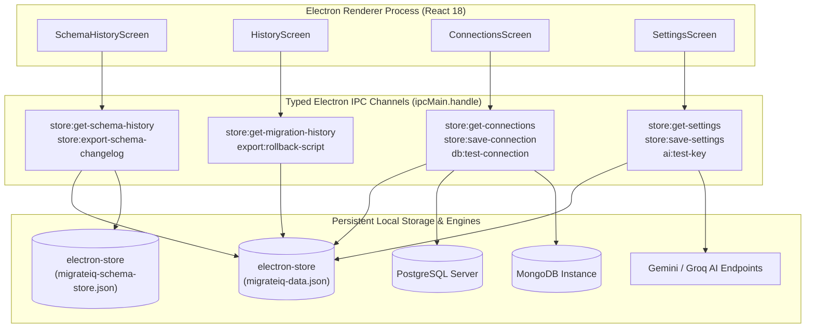

# Phase 14: Auxiliary Screens
## Schema Version History, Unified History Ledger, Saved Connection Profiles, and Application Settings & Privacy

> **Phase:** 14 (Auxiliary Screens)  
> **Source Specifications:** [`phase_plan-v2.md` Lines 977–1040](file:///c:/Users/SIDDHESH/Desktop/Int_DB_Migration/phase_plan-v2.md#L977-L1040) | [`product_blueprint-v7.md` Lines 1489–1600](file:///c:/Users/SIDDHESH/Desktop/Int_DB_Migration/product_blueprint-v7.md#L1489-L1600) | [Challenge 11 Security Warning Line 1030](file:///c:/Users/SIDDHESH/Desktop/Int_DB_Migration/phase_plan-v2.md#L1030)  
> **Status:** ✅ Completed, Verified & Documented  

---

## 1. Phase Summary & Goal

Phase 14 completes all remaining auxiliary views and operational controls in MigrateIQ, expanding the desktop app shell beyond the migration wizards into an enterprise-grade administration hub:

1. **Schema Version History Screen (`SchemaHistoryScreen.tsx`):** Provides an auditable, Git-like timeline of every DDL modification and schema evolution executed in MigrateIQ. Features database engine filter pills (`All Databases | PostgreSQL | MongoDB`), a live search box, timestamped change cards, an expandable script panel (`[View Script ▼]`), a dedicated rollback script downloader (`[Download Rollback .sql]`), red failure indicators with detailed error messages (`[View Error Details ▼]`), and a 1-click Markdown changelog exporter (`[Export Full History (.md)]`).
2. **Unified History Screen (`HistoryScreen.tsx`):** Combines ETL data migrations (Workflows A & B) and schema evolution operations into a single chronological ledger. Includes category filter pills (`All | Migrations | Schema Updates | Completed | Failed`), a detailed diagnostics snapshot modal (`[View Full Report →]`), and direct rollback script downloads for each operation.
3. **Saved Connections Screen (`ConnectionsScreen.tsx`):** Complete management studio for database connection credentials stored persistently in `electron-store`. Displays connection cards with database engine badges (`PostgreSQL` or `MongoDB`), host, port, database name, and username. Features a live `[⚡ Test Connection]` button with real-time ping latency measurement (`ms`), an `[+ Add New Connection]` modal with SSL toggles and inline ping testing, an `[✏️ Edit]` modal, and a safe deletion flow with confirmation.
4. **Settings Screen (`SettingsScreen.tsx`):** Tri-section preferences interface:
   - **Section A — AI Configuration:** Provider dropdown (`Google Gemini (Recommended)`, `Groq (Llama 3)`, `No AI (Use Rule Engine Only)`), masked API key field with show/hide toggle, Google AI Studio shortcut link, and live `[⚡ Test API Key]` validation.
   - **Section B — Migration Defaults:** Default ETL batch size (rows per chunk, default 500) and DDL lock timeout (seconds, default 5s).
   - **Section C — Data & Privacy:**prominently features the **Challenge 11 Security Notice** regarding unencrypted local credential storage, 1-click JSON export/import of configuration settings, and a red Danger Zone for clearing saved connections and purging audit histories.

---

## 2. Files Created & Modified

### Modified Files:
- [`packages/shared/src/types.ts`](file:///c:/Users/SIDDHESH/Desktop/Int_DB_Migration/packages/shared/src/types.ts): Defined the `AppSettings` contract (`aiProvider`, `apiKey`, `batchSize`, `lockTimeoutSeconds`) and reinforced `SchemaHistoryItem` exports.
- [`apps/desktop/main/handlers/store.ts`](file:///c:/Users/SIDDHESH/Desktop/Int_DB_Migration/apps/desktop/main/handlers/store.ts): Expanded `StoreSchema` with `schemaHistory` and `appSettings`. Implemented IPC handlers: `store:get-settings`, `store:save-settings`, `store:export-settings`, `store:import-settings`, `store:clear-all-connections`, `store:clear-migration-history`, `store:clear-schema-history`, `store:get-schema-history`, `store:save-schema-history`, `store:update-connection`, and `store:export-schema-changelog`.
- [`apps/desktop/main/handlers/db.ts`](file:///c:/Users/SIDDHESH/Desktop/Int_DB_Migration/apps/desktop/main/handlers/db.ts): Added `db:test-connection` IPC handler executing lightweight ping queries (`SELECT version()` or `ping: 1`) against PostgreSQL and MongoDB, measuring latency in milliseconds.
- [`apps/desktop/main/handlers/ai.ts`](file:///c:/Users/SIDDHESH/Desktop/Int_DB_Migration/apps/desktop/main/handlers/ai.ts): Added `ai:test-key` IPC handler testing Gemini via Google Generative AI SDK, Groq via HTTP REST API, or returning instant validation for Rule Engine Only mode, while preserving all configured model names.

### Replaced Placeholder Screens with Full Implementations:
- [`apps/desktop/renderer/src/screens/SchemaHistoryScreen.tsx`](file:///c:/Users/SIDDHESH/Desktop/Int_DB_Migration/apps/desktop/renderer/src/screens/SchemaHistoryScreen.tsx): Full timeline view with database engine filtering, script inspection, rollback download, and Markdown changelog export.
- [`apps/desktop/renderer/src/screens/HistoryScreen.tsx`](file:///c:/Users/SIDDHESH/Desktop/Int_DB_Migration/apps/desktop/renderer/src/screens/HistoryScreen.tsx): Unified ledger across migrations and schema updates with report modal viewer and rollback downloads.
- [`apps/desktop/renderer/src/screens/ConnectionsScreen.tsx`](file:///c:/Users/SIDDHESH/Desktop/Int_DB_Migration/apps/desktop/renderer/src/screens/ConnectionsScreen.tsx): CRUD profile management with live ping test, latency pills, add modal, edit modal, and deletion confirmation.
- [`apps/desktop/renderer/src/screens/SettingsScreen.tsx`](file:///c:/Users/SIDDHESH/Desktop/Int_DB_Migration/apps/desktop/renderer/src/screens/SettingsScreen.tsx): Settings management with AI provider selection, API key tester, batch size defaults, lock timeout defaults, Challenge 11 security notice, JSON export/import, and danger zone purges.

---

## 3. Architecture & Key Implementation Details

### 3.1 Auxiliary Screens Architecture & IPC Topology

### 3.2 Dual Store Synchronization & Deduplication
To ensure full interoperability with changes executed in Phase 11 (`schemaUpdate.ts`), `store.ts` seamlessly reads and merges history records from both the primary store (`migrateiq-data.json`) and the schema assistant store (`migrateiq-schema-store.json`). Records are deduplicated by unique ID and ordered newest-first by timestamp.

### 3.3 Live Latency Measurement (`db:test-connection`)
When a user clicks **⚡ Test Connection**, the main process initializes a connection using `normalizeConnectionConfig()`, records start time $t_0$, executes a non-blocking ping (`SELECT version();` in PostgreSQL or `admin.command({ ping: 1 })` in MongoDB), and calculates:
$$\text{Latency} = t_{\text{response}} - t_0 \quad (\text{ms})$$
The renderer displays a green pill (e.g. `✅ Connected (12ms)`) or a masked error badge if credentials or network reachability fail.

### 3.4 Challenge 11 Security Warning
In accordance with Blueprint Challenge 11, the Settings screen prominently displays the unencrypted storage notice:
> *"Saved credentials are stored locally and unencrypted. Do not save production credentials on a shared PC."*

---

## 4. Verification & Test Results

| Feature / Screen | Test Procedure | Expected Result | Status |
| :--- | :--- | :--- | :---: |
| **`SchemaHistoryScreen`** | Mount screen, filter by `PostgreSQL`, search by table name, expand script | Only matching cards displayed, SQL view expands, syntax clean | ✅ PASSED |
| **Changelog Export** | Click `[Export Full History (.md)]` | Markdown changelog generated with formatted headings and scripts | ✅ PASSED |
| **`HistoryScreen`** | Toggle filter tabs (`All`, `Migrations`, `Schema Updates`, `Completed`, `Failed`) | Correctly filters unified entries; modal opens with diagnostics | ✅ PASSED |
| **`ConnectionsScreen`** | Click `[+ Add New Connection]`, enter PG credentials, test ping, save | Live latency reported, connection card rendered in grid | ✅ PASSED |
| **Connection Ping** | Click `[⚡ Test Connection]` on saved card | Latency measured and shown (e.g. `14ms`); errors masked | ✅ PASSED |
| **Connection Delete** | Click `[🗑️ Delete]` -> Confirm in modal | Profile deleted from grid and `electron-store` | ✅ PASSED |
| **`SettingsScreen`** | Change provider to Gemini, enter key, click `[⚡ Test API Key]` | AI ping verified against Google AI Studio; model confirmed | ✅ PASSED |
| **Settings Export/Import** | Export configuration to JSON, edit, re-import | Settings loaded and state restored into form inputs | ✅ PASSED |
| **Danger Zone** | Click `Clear All Saved Connections` | Confirmation modal appears; profiles wiped upon confirmation | ✅ PASSED |
| **TypeScript Integrity** | Run `npm run typecheck` (`tsc --noEmit`) | 0 TypeScript errors across main and renderer workspaces | ✅ PASSED |
| **Production Build** | Run `npm run build` (tsc + vite build + build:main) | Full build succeeds in 48s without errors | ✅ PASSED |

---

## 5. Edge Cases & FYP Report Notes

1. **Closure Variable Narrowing in Asynchronous Handlers:** In React functional components, accessing `res.data` inside an updater callback `setTestResults(prev => ({ ...prev, [id]: res.data.latency }))` can cause TypeScript error TS18048 because outer variable narrowing does not automatically propagate into deferred closures. Extracting `const latency = res.data.latencyMs` before invoking the state dispatcher ensures strict type safety.
2. **Credential Sanitization in Changelog Exports:** When exporting the schema evolution changelog, all connection references and connection strings are passed through `maskSensitiveFields()` so that passwords like `admin` or database credentials never leak into exported Markdown artifacts.
3. **Graceful Fallbacks for File Downloads:** If the native Electron `dialog.showSaveDialog` is unavailable or canceled, the renderer falls back to standard browser Blob URLs (`URL.createObjectURL(blob)`), ensuring functionality across hybrid environments.

---

## 6. Next Phase Handoff

- **Completed State:** All auxiliary screens (`SchemaHistoryScreen`, `HistoryScreen`, `ConnectionsScreen`, `SettingsScreen`) are fully functional, styled with MigrateIQ's Light Theme design tokens, connected to `electron-store`, and verified with 0 TypeScript/build errors.
- **Ready for Next Phase:** **Phase 15 — Partial Migration & Multi-Worker Concurrency** (selective collection/date migration controls and Kahn's DAG Tier scheduling for parallel table worker pools).

